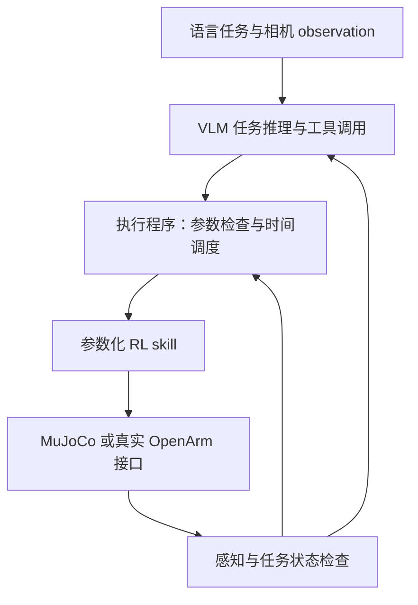

# OpenArm RL 与音乐任务资源

调研日期：2026-10-24。证据来自官方 GitHub README、当前源码、package 配置及 GitHub API。本文包含源码核查与设计建议；没有运行外部项目的训练、回放或真实设备实验。

## OpenArm RL 环境

### enactic/openarm_mjlab

[项目](https://github.com/enactic/openarm_mjlab)，核查 commit：`714b0fbd6c68379dbc259a740b43bba1cca080c8`。

项目使用 MuJoCo Warp、mjlab 和 RSL-RL/PPO，声明 Apache-2.0。依赖包含 `openarm-mujoco` 与 `mjlab>=1.5.0`，Python 要求为 `>=3.11`。

当前 README 和源码包含以下任务：

| Task ID | 行为 |
| --- | --- |
| `OpenArm-Reach` | 右臂到达目标位置 |
| `OpenArm-Lift` | 右臂夹取、抬起并保持方块 |
| `OpenArm-BimanualLift` | 双臂抓住长杆两端并共同抬起 |
| `OpenArm-PickPlace` | 左臂将方块搬运到托盘 |
| `OpenArm-Puck`、`OpenArm-Puck-Vision` | 推动物体到目标区域 |
| `OpenArm-Door`、`OpenArm-Drawer`、`OpenArm-Valve` | 操作带关节的物体 |

源码提供 train、play、eval 入口，以及各项任务的测试文件。README 给出 CUDA 并行训练和 CPU smoke test 命令。仓库文件列表中未发现 `.pt`、`.onnx` 权重，GitHub Releases API 在调研时返回空列表；训练权重的其他发布渠道尚未确认。

源码核查：

- [机器人配置](https://github.com/enactic/openarm_mjlab/blob/714b0fbd6c68379dbc259a740b43bba1cca080c8/src/openarm_mjlab/openarm_bimanual.py) 使用 `openarm_mujoco.v2` 的 pedestal 模型，按电机类型配置 PD gains 和 effort limits。
- [reach 环境](https://github.com/enactic/openarm_mjlab/blob/714b0fbd6c68379dbc259a740b43bba1cca080c8/src/openarm_mjlab/tasks/reach/reach_env_cfg.py) 使用关节位置 action；控制周期为 `0.005 * 4 = 0.02 s`。actor 包含关节位置、速度、末端到目标向量和上一项 action。
- [reach MDP](https://github.com/enactic/openarm_mjlab/blob/714b0fbd6c68379dbc259a740b43bba1cca080c8/src/openarm_mjlab/tasks/reach/mdp.py) 的目标采样区域为世界坐标 `x=[0.25,0.45]`、`y=[-0.35,-0.05]`、`z=[0.45,0.65]` 米。成功条件是位置距离小于 `0.02 m`，并满足关节速度阈值。当前目标没有包含末端姿态。
- [pick-place 环境](https://github.com/enactic/openarm_mjlab/blob/714b0fbd6c68379dbc259a740b43bba1cca080c8/src/openarm_mjlab/tasks/pick_place/pick_place_env_cfg.py) 使用左臂关节位置 action 和夹爪 effort action；控制频率也是 50 Hz。方块具有自由运动关节、质量和摩擦参数，夹取相关 reward 读取两侧 finger pad 的接触 sensor。
- pick-place 的 actor 包含 `pinch` 接触 observation，以及通过仿真物体状态计算的相对位置。部署时需要明确这些 observation 在真实设备上的来源。
- 当前 pick-place 随机化方块位置和朝向，托盘位置为常量 `TRAY_POS`。它需要扩展目标采样和训练，才能形成任意可达位置的参数化 place skill。
- 当前 reach 与 pick-place reset 的机器人姿态主要来自默认姿态附近。需要增加连续调用产生的起始状态，评估 skill 之间的状态衔接。

建议以这个项目作为 MuJoCo RL 的主要代码参考。实际机器人版本需要与模型一致；本地旧 demo 使用 v0.3，另外保存的 ROS 2 模型为 v1.0。不同版本之间的 policy 适用性需要重新训练和验证。

### enactic/openarm_isaac_lab

[项目](https://github.com/enactic/openarm_isaac_lab)，核查 commit：`cb7ff7547bdb81f290591edb9302b4845b1d49a7`。

官方提供单臂 reach、双臂 reach、lift cube、open drawer 的环境，包含 `rsl_rl`、`rl_games`、`skrl` 配置，声明 Apache-2.0。当前 README 标明测试组合为 Isaac Sim 5.1.0、Isaac Lab 2.3.0、Python 3.11、Ubuntu 22.04。

已读取 reach 和 lift 的任务配置：机械臂使用 `JointPositionActionCfg`，lift 的 gripper 使用 `BinaryJointPositionActionCfg`。README 将 sim2real 等接口标为开发中；本次没有验证其真实设备部署能力。

其任务配置、reward 和训练方式可作为第二个官方参考。当前项目已经使用 MuJoCo，`openarm_mjlab` 与现有仿真开发方向直接相关。

## 可复用的乐器资源

### RoboPianist

[项目](https://github.com/google-research/robopianist)，核查 commit：`0d9736c64eba5faafdf214ed7d38d648ffbd5c7f`。

- [piano_mjcf.py](https://github.com/google-research/robopianist/blob/0d9736c64eba5faafdf214ed7d38d648ffbd5c7f/robopianist/models/piano/piano_mjcf.py) 使用 `dm_control.mjcf` 创建钢琴，包含每个按键的几何形状、关节、质量、阻尼、弹簧和行程。
- [piano.py](https://github.com/google-research/robopianist/blob/0d9736c64eba5faafdf214ed7d38d648ffbd5c7f/robopianist/models/piano/piano.py) 提供 88 键的状态、按下判定和 MIDI 模块连接。
- 这些钢琴代码文件声明 Apache-2.0。声音使用 MIDI 与 SoundFont 系统，MIDI 数据和 SoundFont 的授权需分别记录。
- OpenArm 使用钢琴模型时，需要配置自身 TCP、安装姿态、可达按键区域和接触任务。现成的 Shadow Hand policy 与 OpenArm 的 action space 不同。

适用任务：单音按压、松开、给定时刻按键、双臂交替演奏、根据指令改变音符顺序。

### MarimbaBot

[项目](https://github.com/UHHRobotics22-23/MarimbaBot)，核查 commit：`1b444f67e3d6d282c340bde36a1276041c0ddf0c`。

- `marimbabot_description` 保存马林巴琴 URDF/Xacro、各个音条的独立名称与目标坐标、琴槌和夹具模型；该 package 声明 Apache License Version 2.0。
- `marimba.urdf.xacro` 保存音条尺寸、两排布局、质量及 collision geometry，并支持固定或活动音条配置。
- `marimbabot_simulation` 提供 Gazebo 场景、击打检测和 MIDI 生成。说明文件描述了根据音条关节速度阈值检测击打的方式。
- 接入 MuJoCo 需要使用 Xacro 生成 URDF，导入模型，并验证碰撞、质量、关节、接触参数和音符事件检测。Gazebo 专用设置需要在 MuJoCo 中明确配置。

适用任务：夹取琴槌、移动至目标音条上方、按时击打、交替演奏和演奏完成后的工具归位。

## 参数化 skill 与执行接口

以下内容是针对当前项目的设计建议。

训练接口使用 `policy(observation, goal)`。每一种行为共享参数化 policy，目标位置、姿态、物体和时序作为输入。训练数据需要覆盖技能连续执行产生的机器人状态、持物状态和工具姿态。

| Tool | 主要参数 | 完成条件 |
| --- | --- | --- |
| `reach` | `arm`、`target_pose`、`frame`、`timeout_s` | 位置与姿态误差满足阈值并保持稳定 |
| `pick` | `arm`、`object_id`、`grasp_pose` | 夹持并抬起物体，在指定时间内保持稳定 |
| `place` | `arm`、`target_pose`、`frame` | 释放物体，物体在目标区域稳定，机械臂完成撤离 |
| `strike` | `arm`、`instrument_id`、`target_id`、`hit_time`、`intensity` | 指定目标发生接触，记录时刻和接触速度或冲量 |
| `press_key` | `arm`、`key_id`、`onset_time`、`duration` | 按键激活时刻和持续时间满足目标 |

运行时接口还需要：

- `observe`：返回相机 observation、标定后的物体位姿、关节状态、工具持有状态及各项状态的时间戳。
- `start_skill`：校验参数、坐标系、当前状态、工作空间和执行资源，启动一项 skill 并返回 `execution_id`。
- `get_skill_status`：返回 `running`、`succeeded`、`failed`、`cancelled`，以及位置误差、目标状态、失败原因和执行时间。
- `cancel_skill`：取消执行，按设备控制方式完成受控停止。
- `play_pattern`：接收完整时间事件序列，预先检查双臂占用和转移动作是否可行，再使用共同时间基准调度 policy。属于执行程序提供的组合能力。

policy observation 与 critic observation 需要分别定义。actor 使用真实设备可获得的输入；仿真中的物体真值和接触状态可以用于 critic、reward 或监督目标。真实设备无法直接提供的输入，需要有经过验证的估计模块，或在重新训练时调整 actor 输入。

sim2real 需要明确机器人版本、关节名称和顺序、TCP、单位、方向与零点、action scale、关节位置目标与夹爪 effort 的含义、控制频率、延迟、观测归一化和力矩限制。训练时随机化经过标定范围内的动力学、摩擦和延迟，并使用真实设备可获得的 observation 评估。

## VLM 调用 skill 的结构

VLM 根据语言、相机和结构化状态选择目标、工具以及 skill 参数。执行程序负责参数检查、skill 生命周期、状态检查、共同时间基准和双臂资源协调。RL policy 按固定控制周期与仿真或真实设备交互。

音乐任务同时包含准备动作和连续节奏。VLM 可以选择曲段、节奏、音符顺序、双臂分工和失败恢复；执行程序根据完整事件序列调度击打时刻。时序参数需要传递至 skill，训练 reward 同时评估目标、时刻和强度。

示例组合任务：识别目标琴槌和乐器，夹取琴槌，完成指定音符或节奏序列，根据新的指令改变曲段，最后将琴槌放回指定区域。评估同时记录取放成功率、正确目标击打率、时刻误差、额外击打次数及完整任务成功率。

[SayCan](https://github.com/google-research/google-research/tree/master/saycan) 已研究语言模型选择低层 skill，并使用 skill 的可执行性估计辅助选择。这里的研究问题可以进一步关注带时间约束的组合、连续调用的状态衔接、感知误差和执行失败后的恢复。

## 实验条件

| 条件 | 比较目的 |
| --- | --- |
| 已知正确 skill 序列，使用同一批 RL policy | 测量 skill 与执行程序能够达到的组合能力 |
| VLM 生成完整序列，按序执行 | 测量一次任务规划的表现 |
| VLM 在 skill 完成或失败后读取状态并重新决策 | 测量闭环任务推理的收益 |
| 在给定范围随机改变目标、布局、起始姿态和节奏 | 测量 goal conditioning 和组合泛化 |
| 对具有精确时刻要求的任务使用共同时间基准 | 测量事件调度与 policy 时序控制的表现 |

数据按 skill 训练集、skill 评估集和组合任务评估集分别保存。组合评估包含训练中未出现的 skill 顺序和目标布局。各项结果注明训练 seed、模型版本、checkpoint、环境版本、试验数量和成功条件。

当前证据支持开始使用官方环境开发和评估参数化 skill。现成 policy 的训练成功率、组合任务性能、资产在当前 MuJoCo 环境中的接触表现和 sim2real 效果均尚未复现。
